# Pengenalan Kartu Remi dengan Pencocokan Fitur ORB dan SIFT

UTS Praktikum Visi Komputer — Tema 9, Kelompok 9, Informatika, Universitas Syiah Kuala.

**Website (Streamlit):** https://pengenalan-kartu-remi.streamlit.app

## Nama Anggota Tim dan NPM

| Nama | NPM |
|---|---|
| Muhammad Yazid Arrazi | 2408107010072 |
| Muhammad Farhan Alafif | 2408107010075 |
| Muhammad Razi Siregar | 2408107010101 |

## Deskripsi

Program mengenali kartu remi pada foto (misalnya "7 Hati") dan menampilkan nama kartu beserta jumlah *good match* sebagai ukuran keyakinan. Kartu yang dikenali adalah nilai **3, 7, dan 10** pada jenis **hati, wajik, keriting, sekop** (12 template). Satu foto boleh berisi sampai dua kartu.

Pendekatannya visi komputer klasik tanpa *deep learning*: kartu dideteksi lewat kontur, diluruskan dengan `warpPerspective`, lalu fitur **ORB** atau **SIFT** dicocokkan ke 12 template. Library yang dipakai hanya `opencv-python`, `numpy`, dan `matplotlib` (ditambah `streamlit` untuk website).

Program diuji pada empat kondisi foto: kartu **diputar**, **jauh**, terkena **bayangan/pantulan lampu**, dan latar **sulit** (kain batik, dua kartu, foto buram).

## Pipeline

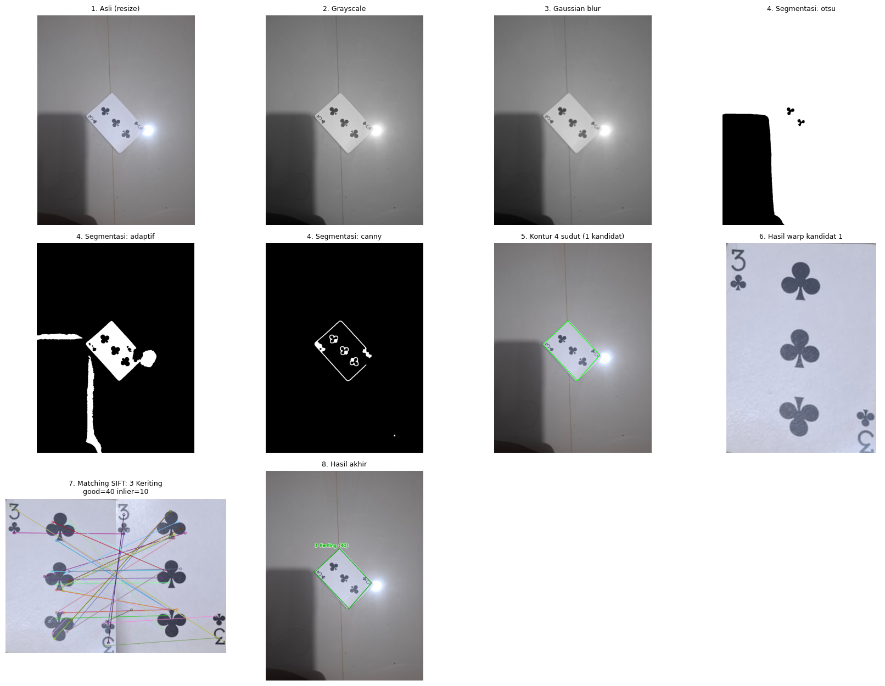

```
foto -> resize 1000 px -> grayscale -> Gaussian blur 7x7
     -> segmentasi (Otsu + adaptive threshold + Canny, kandidat digabung)
     -> kontur -> convexHull -> approxPolyDP (4 sudut)
     -> warpPerspective ke 300x420 (dari foto resolusi penuh)
     -> equalizeHist -> fitur ORB / SIFT
     -> BFMatcher + knnMatch + ratio test 0,75 (template dibatasi ke warna yang sama lewat HSV)
     -> template dengan good match terbanyak (>= ambang) -> nama kartu
```

| Tahap | Metode dan parameter |
|---|---|
| 1. Praproses | `imread`, resize sisi terpanjang 1000 px (`INTER_AREA`), grayscale, Gaussian blur 7x7 |
| 2. Segmentasi | Otsu, adaptive threshold Gaussian (blok 201, C = -8), Canny (40, 120), closing; kandidat dari ketiganya digabung |
| 3. Deteksi kartu | `findContours`, `convexHull`, `approxPolyDP` (epsilon 2-6% keliling, dinaikkan bertahap sampai 4 titik); saringan luas 1-60% foto, rasio tinggi/lebar mendekati 1,4, sudut mendekati 90 derajat; cadangan `minAreaRect` dan `boundingRect` |
| 4. Pelurusan | `findHomography` + `warpPerspective` dari foto resolusi penuh ke 300x420; rotasi 0 dan 180 derajat dicoba keduanya |
| 5. Fitur | `equalizeHist`, lalu SIFT (maks. 1000 keypoint) atau ORB |
| 6. Pencocokan | `BFMatcher` (L2 untuk SIFT, Hamming untuk ORB), `knnMatch` k = 2, ratio test 0,75; template dibatasi ke warna yang sama (merah/hitam) dengan HSV |
| 7. Keputusan | Template dengan good match terbanyak diterima bila skor >= ambang (SIFT 20, ORB 10); selain itu "tidak dikenali" |

Ambang "tidak dikenali" dipilih dari sebaran skor kartu benar dan salah:

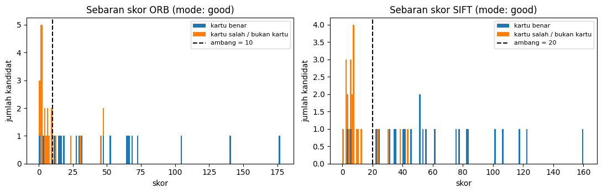

## Dataset

Seluruh foto diambil sendiri dengan kamera HP (Samsung A55) pada 16 Oktober 2026. Kartu: satu set kartu remi, 12 kartu terpilih (nilai 3, 7, 10 pada empat jenis). Jawaban benar tiap foto ada di `dataset/ground_truth.csv`.

| Folder | Jumlah | Keterangan |
|---|---|---|
| `dataset/template/` | 12 | Foto referensi tiap kartu (dipotong/diluruskan otomatis menjadi 300x420) |
| `dataset/rotasi/` | 12 | Satu kartu, diputar 45 derajat (8 foto) dan 90 derajat (4 foto), jarak sekitar 25 cm |
| `dataset/skala/` | 3 | Satu kartu difoto dari jauh, sekitar 40 cm |
| `dataset/cahaya/` | 6 | Satu kartu dengan bayangan atau pantulan lampu |
| `dataset/sulit/` | 7 | Latar kain batik, kartu kecil, foto buram, dan tiga foto berisi dua kartu |
| **Foto uji** | **28** | Template tidak dipakai sebagai foto uji |

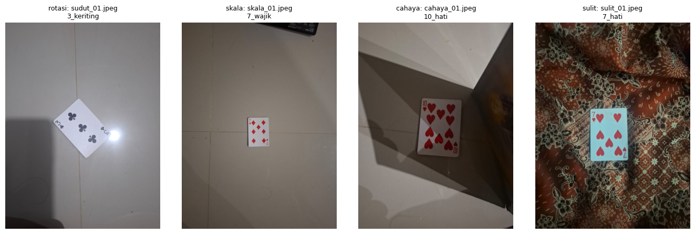

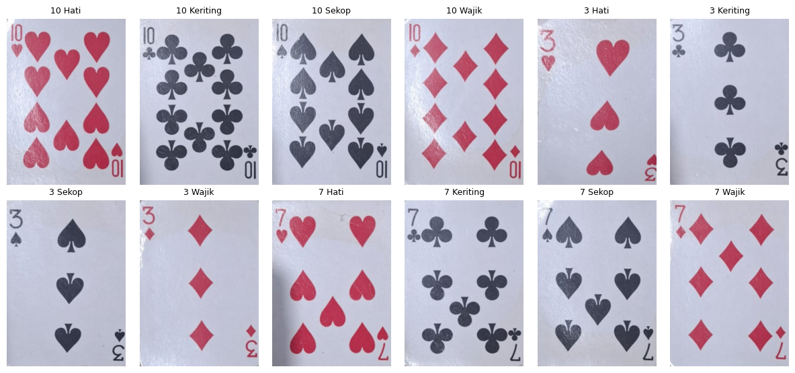

## Hasil

Sebuah foto dihitung **benar** bila himpunan kartu yang dikenali sama persis dengan ground truth (foto dua kartu: kedua kartu harus benar). Angka di bawah dapat direproduksi dengan `python evaluasi.py`.

| Kondisi | ORB | SIFT |
|---|---|---|
| Rotasi | 66,7% (8/12) | 83,3% (10/12) |
| Skala | 66,7% (2/3) | 66,7% (2/3) |
| Cahaya | 83,3% (5/6) | 66,7% (4/6) |
| Sulit | 0,0% (0/7) | 42,9% (3/7) |
| **Semua** | **53,6% (15/28)** | **67,9% (19/28)** |

Contoh hasil (SIFT; label dan jumlah good match tertera di atas kotak kartu):

| Rotasi | Dua kartu | Jauh (40 cm) | Cahaya |
|---|---|---|---|
| 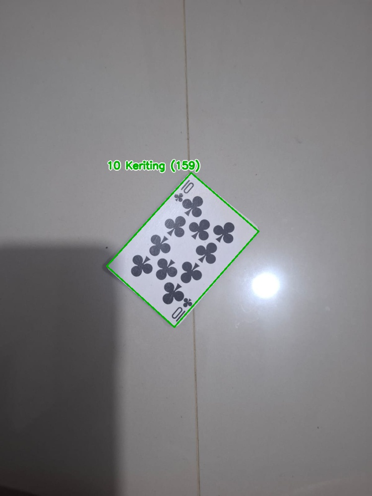 | 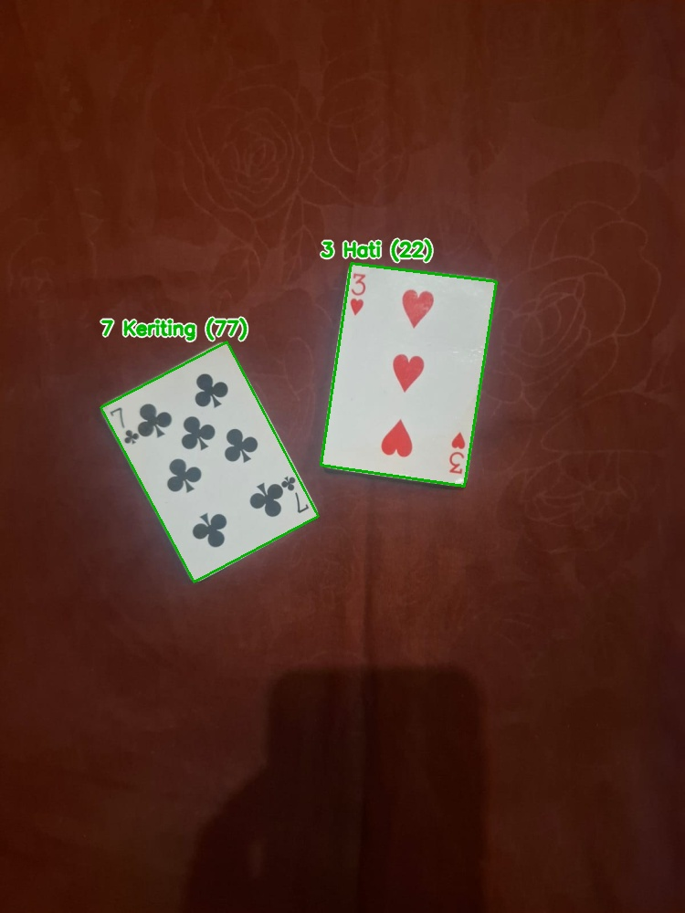 | 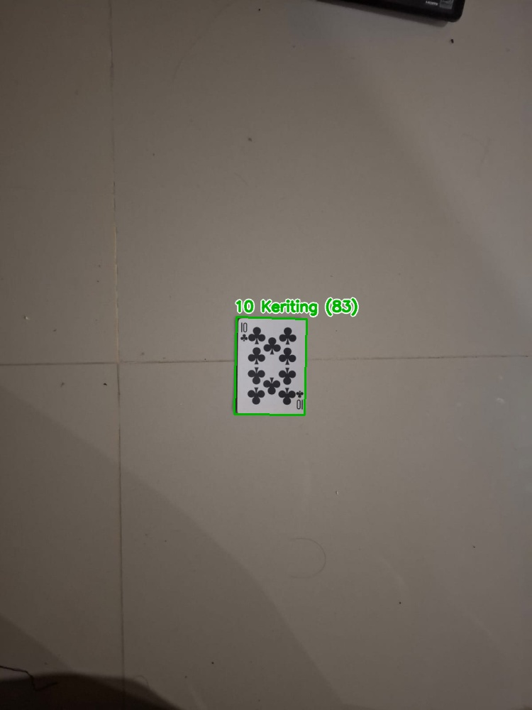 | 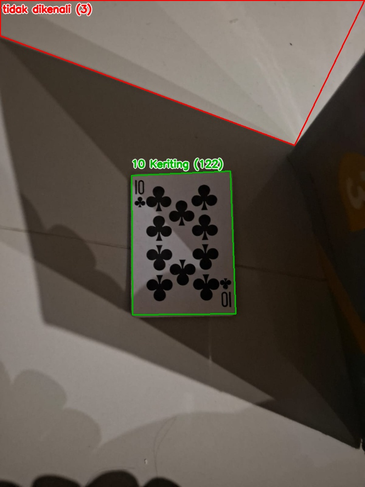 |

Hasil seluruh foto uji tersimpan di `output/hasil_sift/` dan `output/hasil_orb/`.

**Kegagalan SIFT (9 foto)** dan penyebabnya:

| File | Hasil | Penyebab |
|---|---|---|
| `sudut_02`, `cahaya_05` | 3 Hati terbaca 3 Wajik | Kartu merah dengan tata letak tiga simbol sama; filter warna tidak membantu |
| `skala_03`, `cahaya_06` | Sekop terbaca Keriting | Kartu hitam dengan tata letak sama; simbol kecil pada 40 cm atau tertutup bayangan |
| `sudut_10`, `sulit_01` | Tidak dikenali | Kartu kecil di dekat pantulan lampu atau di atas kain batik; kontur 4 sudut tidak ditemukan |
| `sulit_02`, `sulit_05` | Tidak dikenali | Kandidat terpilih adalah potongan motif batik, bukan kartu |
| `sulit_07` | Tidak dikenali | Foto buram dengan latar sampul buku berwarna-warni |

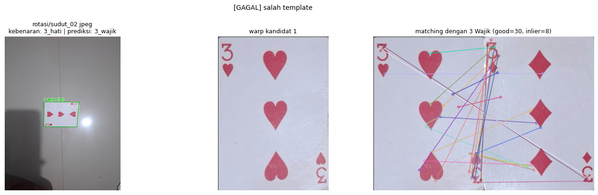
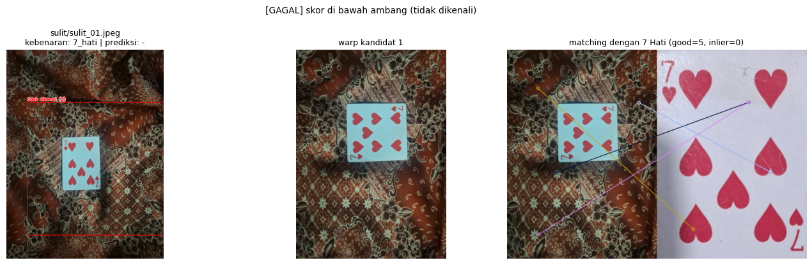

## Eksperimen Pembanding

ORB dan SIFT dibandingkan pada pipeline yang sama (hanya detektor fitur yang berbeda).

| Metrik | ORB | SIFT |
|---|---|---|
| Akurasi total | 53,6% | 67,9% |
| Rata-rata keypoint per kartu | 388 | 505 |
| Rata-rata good match (kartu diterima) | 51,0 | 61,5 |
| Rata-rata inlier RANSAC (kartu diterima) | 32,6 | 29,3 |
| Waktu pengenalan (ms/foto) | 109 | 439 |

Akurasi per sudut rotasi dan per jarak:

| Kelompok | ORB | SIFT |
|---|---|---|
| Sudut 45 derajat | 50,0% (4/8) | 87,5% (7/8) |
| Sudut 90 derajat | 100,0% (4/4) | 75,0% (3/4) |
| Jarak 25 cm | 66,7% (8/12) | 83,3% (10/12) |
| Jarak 40 cm | 66,7% (2/3) | 66,7% (2/3) |

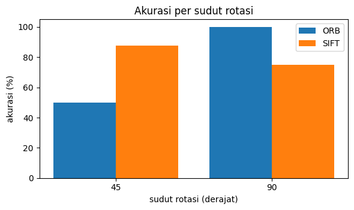 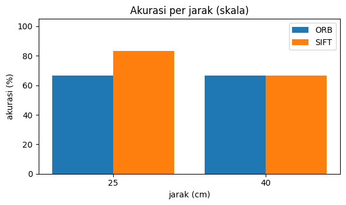

Pengaruh ratio test, jenis skor, dan filter warna terhadap akurasi total:

| Konfigurasi | ORB | SIFT |
|---|---|---|
| Dasar (rasio 0,75; good match; filter warna HSV) | 53,6% | 67,9% |
| Tanpa filter warna HSV | 50,0% | 50,0% |
| Rasio 0,6 | 25,0% | 35,7% |
| Rasio 0,7 | 46,4% | 60,7% |
| Rasio 0,8 | 60,7% | 67,9% |
| Skor = inlier RANSAC | 46,4% | 46,4% |

**Ringkasan:** SIFT lebih akurat (terutama rotasi 45 derajat dan foto sulit) tetapi sekitar 4 kali lebih lambat; ORB lebih cepat. Filter warna HSV menaikkan akurasi SIFT dari 50,0% ke 67,9%. Rasio 0,6 terlalu ketat untuk data ini.

**Keterbatasan:** dataset kecil (12 template, 28 foto uji, satu foto mengubah akurasi kondisi 8-33 poin); rotasi hanya 45 dan 90 derajat; foto skala hanya tiga pada satu jarak; ambang "tidak dikenali" dipilih dari data yang sama dengan data uji sehingga akurasi cenderung sedikit optimis; deteksi kartu rapuh pada latar bermotif.

## Cara Install di laptop lokal

Butuh Python 3.10 atau lebih baru dan Git.

```bash
# 1. Ambil kode
git clone https://github.com/Xirenaa/Pengenalan-Kartu-Remi.git
cd Pengenalan-Kartu-Remi

# 2. (disarankan) buat virtual environment
python -m venv .venv
# Windows:
.venv\Scripts\activate
# macOS / Linux:
source .venv/bin/activate

# 3. Pasang library
pip install -r requirements.txt

# 4. Jalankan website Streamlit (buka http://localhost:8501)
streamlit run app.py
```

Website menerima unggahan foto (JPG/PNG), menampilkan gambar asli dan hasil berdampingan, serta informasi hasil (jumlah kartu, label, good match, waktu proses). Algoritma (SIFT/ORB) bisa dipilih di sidebar, dan tersedia pilihan "Contoh dari dataset".

Menjalankan evaluasi dan notebook:

```bash
python evaluasi.py                     # akurasi ORB dan SIFT pada 28 foto uji
pip install notebook
jupyter notebook UTS_Kelompok09.ipynb  # jalankan dari folder ini agar dataset/ terbaca
```

## Struktur repo

```
app.py               website Streamlit
kartu_remi.py        pipeline (diambil dari notebook, logika tidak diubah)
evaluasi.py          skrip evaluasi 28 foto uji
UTS_Kelompok09.ipynb notebook lengkap (pipeline, eksperimen, analisis)
requirements.txt
dataset/             template, foto uji, ground_truth.csv
output/              hasil anotasi seluruh foto uji (SIFT dan ORB)
assets/              gambar untuk README
```
